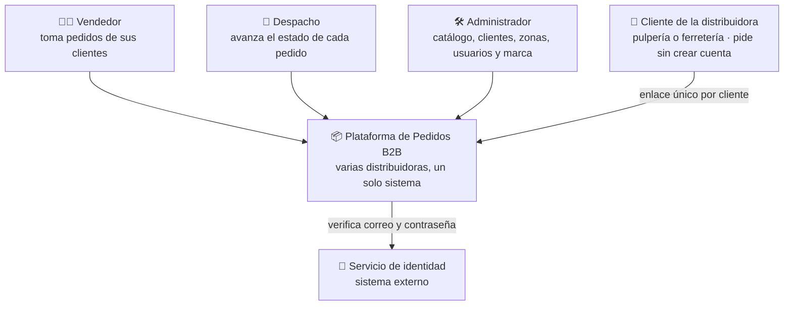
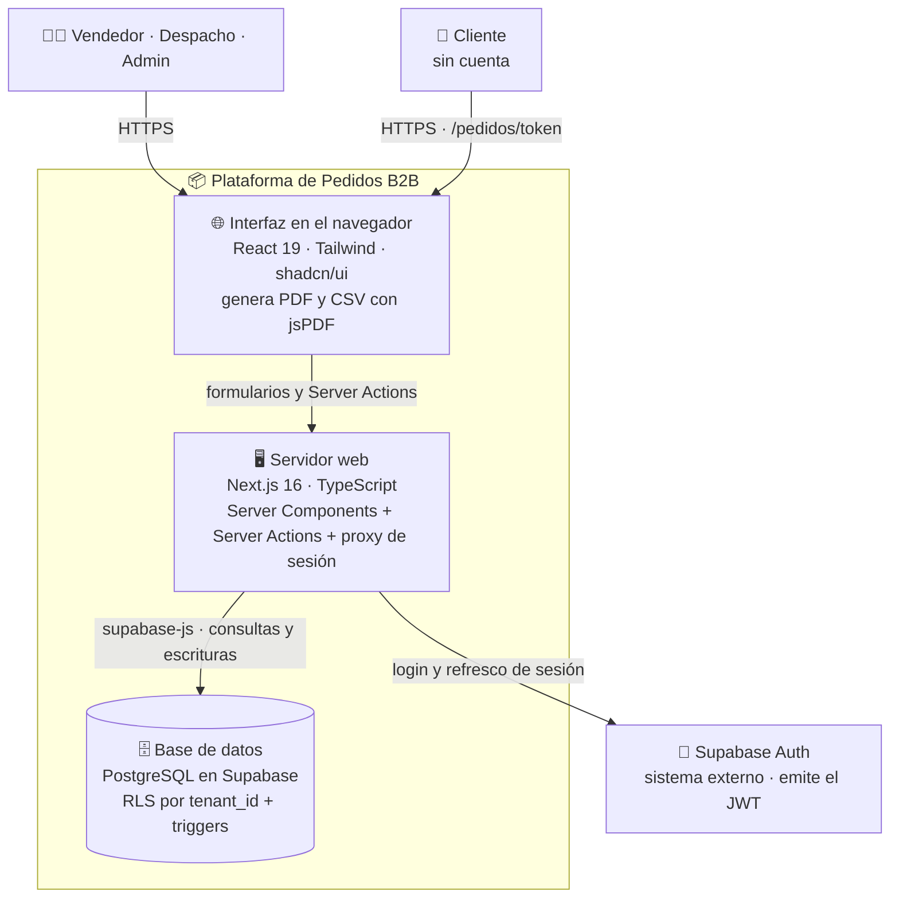

# Práctica 6 · Arquitectura de Pedidos B2B (C4 en Mermaid)

Sistema: plataforma SaaS de pedidos B2B para distribuidoras (multi-tenant:
varias distribuidoras usan el mismo código y la misma base de datos).

---

## Nivel 1 · Contexto

**Decisiones y atributos de calidad**

1. **El cliente pide con un enlace único, sin crear cuenta.** Prioricé
   disponibilidad y facilidad de uso sobre seguridad estricta: es la lección de
   Healthcare.gov al revés — no pongo la verificación de identidad como portera.
   El precio es que quien tenga el enlace puede pedir; lo mitigo con un token
   opaco, único por distribuidora, y el servidor nunca confía en precios ni en
   el tenant que mande el navegador: los vuelve a calcular a partir del token.
2. **Un solo sistema para todas las distribuidoras.** Prioricé costo y
   mantenibilidad (una distribuidora nueva es una fila, no una instalación
   nueva) sobre aislamiento total entre clientes, que se resuelve en el nivel 2.

---

## Nivel 2 · Contenedores

**Decisiones y atributos de calidad**

1. **Un esquema compartido con `tenant_id` + Row Level Security**, en vez de un
   esquema o una base por distribuidora. Prioricé mantenibilidad y costo (una
   sola migración actualiza a todos; el costo no crece con cada cliente) sobre
   aislamiento físico. El precio: un error en una policy podría mostrar datos
   de otra distribuidora. Por eso `FORCE ROW LEVEL SECURITY` en todas las tablas
   y un seed con dos distribuidoras distintas para comprobarlo a simple vista.
2. **Los reportes PDF/CSV se generan en el navegador, no en el servidor.**
   Prioricé simplicidad y costo (el servidor no hace trabajo pesado ni guarda
   archivos) sobre rendimiento en equipos lentos con muchos pedidos. Los
   totales y precios sí se calculan en el servidor: ahí la seguridad pesa más
   que la velocidad.

---

## Correcciones al borrador de la IA

<!-- Revisá esta lista y dejá solo lo que de verdad corregiste vos. -->

- El borrador ponía "Supabase" y "Next.js" en el nivel 1 → los quité: nivel 1 = cero tecnologías. Quedó como "Servicio de identidad".
- Aparecía "Operador de bodega (login por PIN)" como actor → lo quité: esa pantalla todavía es un placeholder, no existe en el sistema.
- Dibujaba `proxy.ts` como contenedor aparte → es parte del servidor Next.js (corre en el mismo proceso), no se despliega por separado.
- Inventaba un contenedor "API REST" → no existe: el navegador habla con el servidor por Server Actions de Next.js.
